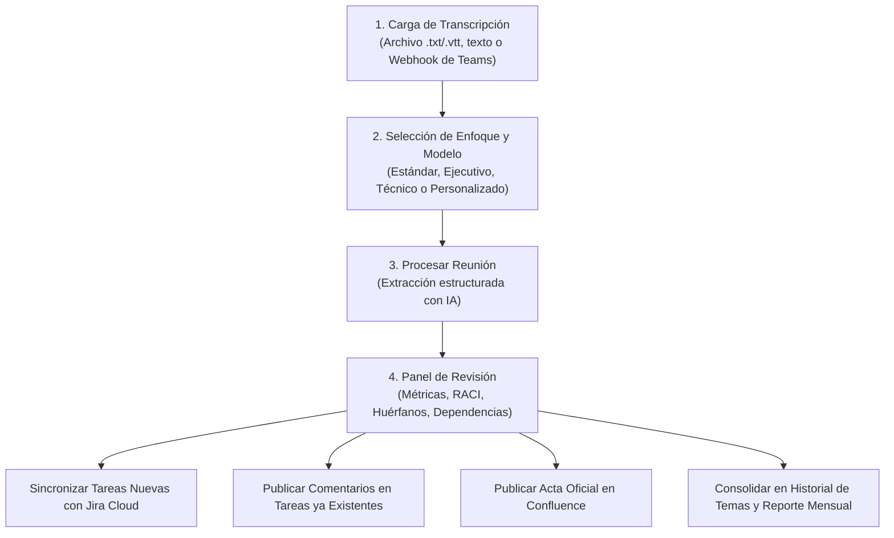
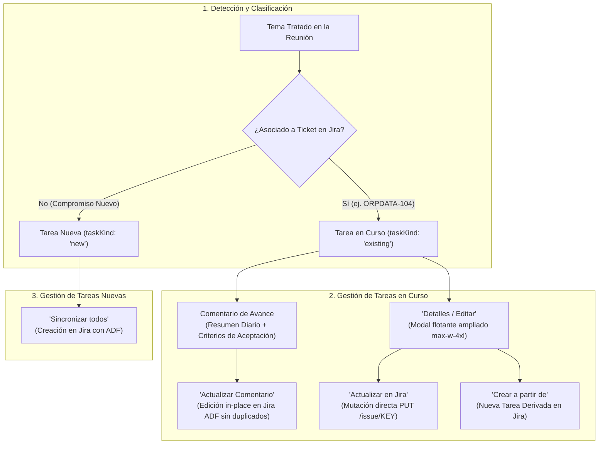

# ProjectHandler 🚀

> **Plataforma Integral de Gestión Inteligente y Automatizada de Reuniones Ágiles**  
> Desarrollado por **Cívica Software** para transformar transcripciones de reuniones (Microsoft Teams) en tareas ejecutables en **Jira Cloud**, actas oficiales en **Confluence**, matrices RACI, mapas de dependencias y reportes ejecutivos consolidados mediante Inteligencia Artificial Multi-Proveedor.
>
> 📖 **Guía Visual de la Interfaz Gráfica:** Para un recorrido visual paso a paso con capturas de pantalla de todas las vistas, modales y flujos operativos, consulta el documento [UI_GUIDE.md](file:///c:/Users/juan.artigas/ProjectHandler/UI_GUIDE.md).

---

## 📋 Tabla de Contenidos

1. [Visión General del Framework](#-visión-general-del-framework)
2. [Arquitectura y Tecnologías](#-arquitectura-y-tecnologías)
3. [Guía Funcional (Para Analistas, Scrum Masters y Product Managers)](#-guía-funcional-para-analistas-scrum-masters-y-product-managers)
   - [Flujo de Trabajo Operativo](#flujo-de-trabajo-operativo)
   - [Modos de Análisis y Estructuración de Prompts](#modos-de-análisis-y-estructuración-de-prompts)
   - [Detección de Compromisos Huérfanos y Matriz RACI](#detección-de-compromisos-huérfanos-y-matriz-raci)
   - [Gestión de Tareas en Curso vs. Tareas Nuevas](#gestión-de-tareas-en-curso-vs-tareas-nuevas)
   - [Comentarios de Avance y Criterios de Aceptación Estructurados](#comentarios-de-avance-y-criterios-de-aceptación-estructurados)
   - [Actualización Real en Jira y Creación Derivada ("Crear a partir de")](#actualización-real-en-jira-y-creación-derivada-crear-a-partir-de)
   - [Gestión de Temas Asociados y Categorización Flexible](#gestión-de-temas-asociados-y-categorización-flexible)
   - [División de Criterios de Aceptación (Split Criteria)](#división-de-criterios-de-aceptación-split-criteria)
   - [Vinculación Nativa en Jira Cloud (Issue Linking) y Grafo de Dependencias](#vinculación-nativa-en-jira-cloud-issue-linking-y-grafo-de-dependencias)
   - [Selector de Épica Padre (Parent Epic)](#selector-de-épica-padre-parent-epic)
   - [Campos de Texto con Auto-Ajuste de Altura Dinámico (AutoResizeTextarea)](#campos-de-texto-con-auto-ajuste-de-altura-dinámico-autoresizetextarea)
   - [Histórico de Reuniones y Seguimiento de Temas](#histórico-de-reuniones-y-seguimiento-de-temas)
   - [Generación de Informes Mensuales Consolidados](#generación-de-informes-mensuales-consolidados)
4. [Guía Técnica (Para Desarrolladores, Arquitectos y DevOps)](#-guía-técnica-para-desarrolladores-arquitectos-y-devops)
   - [Motor de Inteligencia Artificial Multi-Proveedor](#motor-de-inteligencia-artificial-multi-proveedor)
   - [Configuración de Modelos de Fábrica desde `.env`](#configuración-de-modelos-de-fábrica-desde-env)
   - [Modelos Personalizados y Validación en Tiempo Real](#modelos-personalizados-y-validación-en-tiempo-real)
   - [Manejo de Errores de API y Modal Informativo](#manejo-de-errores-de-api-y-modal-informativo)
   - [Integración con Jira Cloud y Confluence](#integración-con-jira-cloud-y-confluence)
     - [Jira Cloud REST API (v3)](#jira-cloud-rest-api-v3)
     - [Motor de Renderizado Atlassian Document Format (ADF)](#motor-de-renderizado-atlassian-document-format-adf)
     - [Modo Simulación y Resiliencia Offline](#modo-simulación-y-resiliencia-offline)
     - [Confluence Cloud REST API](#confluence-cloud-rest-api)
   - [Recepción Automática vía Webhook (Teams / Power Automate)](#recepción-automática-vía-webhook-teams--power-automate)
   - [Referencia de Endpoints del Backend REST](#referencia-de-endpoints-del-backend-rest)
5. [Instalación y Puesta en Marcha](#-instalación-y-puesta-en-marcha)
6. [Configuración de Variables de Entorno (`.env`)](#-configuración-de-variables-de-entorno-env)
7. [Estructura del Proyecto](#-estructura-del-proyecto)
8. [Seguridad y Privacidad](#-seguridad-y-privacidad)

---

## 💡 Visión General del Framework

En el día a día de los equipos técnicos y de negocio (reuniones diarias, refinamientos de backlog, comités de arquitectura, sesiones de seguimiento con clientes), se adoptan decenas de compromisos verbales, estimaciones y acuerdos de entrega. Con frecuencia ocurren tres problemas comunes:

1. **Compromisos Huérfanos:** Compromisos verbales ("yo reviso la query", "después subimos el fix") que se desvanecen al no contar con un responsable explícito o una estimación asignada.
2. **Duplicidad y Ruido en Jira:** Crear tickets para tareas que ya existían previamente en el tablero y que solo recibieron una actualización verbal en la reunión.
3. **Pérdida de Trazabilidad Histórica:** Las minutas quedan archivadas en correos o notas locales, impidiendo ver la evolución de un tema a lo largo de semanas o meses.

**ProjectHandler** resuelve este ciclo conectando la transcripción de la sesión directamente con el ecosistema de entrega:
- Ingiere transcripciones por texto, subida de ficheros (`.vtt`, `.txt`, `.docx`) o recepción automática mediante **Microsoft Power Automate**.
- Analiza la sesión utilizando modelos avanzados de IA (**Claude, OpenAI, Azure Copilot, Google Gemini**).
- Detecta si un tema corresponde a una **tarea en curso existente** en Jira (redactando comentarios ejecutivos) o a una **tarea nueva** (estructurando título, responsable, Story Points, Criterios de Aceptación y Definition of Done).
- Provee sincronización en un clic con **Jira Cloud**, publicación de actas oficiales en **Confluence**, consulta bidireccional del estado real de las incidencias y agregación de **Informes Mensuales**.

---

## 🛠️ Arquitectura y Tecnologías

```
┌─────────────────────────────────────────────────────────────────────────────┐
│                              FRONTEND (SPA)                                 │
│  React 19 • TypeScript • Tailwind CSS v4 • Vite • Lucide Icons              │
│  - Persistencia segura y sin servidores externos en localStorage            │
│  - Sistema reactivo de eventos internos para modelos y configuraciones      │
│  - Modales enriquecidos de edición Jira, Confluence, diagnósticos de IA     │
└──────────────────────────────────────┬──────────────────────────────────────┘
                                       │ Peticiones HTTP / Proxy Vite
┌──────────────────────────────────────▼──────────────────────────────────────┐
│                           BACKEND EXPRESS (server.ts)                       │
│  Node.js • Express • TypeScript (tsx) • dotenv                              │
│  - /api/ai/models & /api/ai/test-connection (Catálogo configurable de IA)   │
│  - /api/analyze-transcript (Motor de análisis con esquema JSON garantizado) │
│  - /api/jira/* (Búsqueda JQL, autocompletado de usuarios, creación y ADF)  │
│  - /api/confluence/* (Generación y publicación de actas jerárquicas)        │
│  - /api/teams/webhook (Recepción de eventos Microsoft Graph / OneDrive)     │
└──────────────────┬───────────────────────────────┬──────────────────────────┘
                   │                               │
┌──────────────────▼───────────────┐ ┌─────────────▼──────────────────────────┐
                   │               │               │
┌──────────────────▼───────────────┐ ┌─────────────▼──────────────────────────┐
│        PROVEEDORES DE IA         │ │          ECOSISTEMA ATLASSIAN          │
│ • Anthropic Claude (3.7 / 3.5)   │ │ • Jira Cloud REST API v2/v3            │
│ • OpenAI (GPT-4o, o3-mini)       │ │   (Incidencias, Tableros, Comentarios) │
│ • Azure OpenAI / MS Copilot      │ │ • Confluence Cloud REST API            │
│ • Google Gemini (3.8, 3.1, 2.5)  │ │   (Páginas de espacio corporativo)     │
└──────────────────────────────────┘ └────────────────────────────────────────┘
```

---

## 👥 Guía Funcional (Para Analistas, Scrum Masters y Product Managers)

### Flujo de Trabajo Operativo



#### Paso 1: Cargar la Transcripción
1. Dirígete a la pestaña **Procesar Reunión**.
2. Tienes tres alternativas para introducir la información:
   - **Subir Archivo:** Haz clic en la zona de carga y selecciona un archivo `.vtt`, `.txt` o `.docx`. El título de la reunión se completará automáticamente con el nombre del archivo.
   - **Pegar Texto:** Copia la transcripción directamente desde Teams y pégala en el editor.
   - **Teams en Vivo (Webhook):** Si tu organización tiene activo el flujo de Power Automate, las reuniones grabadas aparecerán automáticamente listas para procesar.
3. Ajusta el título y la fecha de la sesión según corresponda.

#### Paso 2: Elegir Enfoque Analítico y Modelo
- **Motor de IA:** Selecciona el proveedor (**Claude, OpenAI, Copilot o Gemini**) y el modelo a utilizar. El desplegable incluye tanto los modelos oficiales como los modelos personalizados guardados.
- **Formato del Prompt:** Selecciona el tipo de análisis deseado:
  - **Estándar Ágil (Jira-Ready):** Centrado en tareas operativas, impedimentos diarios y compromisos del sprint.
  - **Ejecutivo (Comités y Dirección):** Foco en decisiones estratégicas, riesgos comerciales y acuerdos clave.
  - **Técnico (Arquitectura e Ingeniería):** Foco en deuda técnica, endpoints, esquemas de datos, despliegues y calidad.
  - **Personalizado (Custom):** Permite ingresar directrices a medida y guardarlas en hasta 3 slots accesibles rápidamente.

#### Paso 3: Revisión y Enriquecimiento
Una vez finalizado el análisis, la pestaña **Resumen & Tickets** despliega los resultados organizados:
- **Resumen Ejecutivo:** Puntos esenciales acordados y decisiones registradas.
- **Métricas de Capacidad:** Comparativa entre la suma de Story Points asignados y el límite por miembro.
- **Compromisos Huérfanos:** Diálogos donde se prometió una entrega sin un dueño claro. Permite asignar un participante con un solo clic.
- **Matriz RACI:** Tabla de asignación de roles (Responsable, Aprobador, Consultado, Informado).
- **Mapa de Dependencias:** Identifica visualmente qué participante o tarea bloquea el avance de otro compañero.

#### Paso 4: Publicación y Sincronización
- **Sincronizar todos:** Envía a Jira únicamente las **tareas nuevas**.
- **Actualizar / Agregar Comentario:** Para tareas en curso en Jira, publica o edita in-place el avance técnico con sus criterios de aceptación en formato ADF nativo, evitando comentarios duplicados.
- **Detalles / Editar (Ventana Flotante Ampliada):** Permite modificar campos directamente en Jira Cloud (**"Actualizar en Jira"**) o clonar el contenido hacia una nueva tarjeta independiente (**"Crear a partir de"**).
- **Sincronizar estados:** Consulta Jira en tiempo real para refrescar el estado de los tickets (*To Do*, *In Progress*, *Done*).
- **Publicar en Confluence:** Genera el documento oficial de la reunión en el espacio configurado.
- **Compartir por Email / Exportar:** Permite copiar un correo ejecutivo o descargar el reporte en Markdown o CSV.

---

### Modos de Análisis y Estructuración de Prompts

ProjectHandler incluye plantillas optimizadas para evitar alucinaciones y garantizar que los resultados cumplan con las directivas de entrega:

| Modo de Prompt | Audiencia Objetivo | Salida Principal |
| :--- | :--- | :--- |
| **Estándar Ágil** | Equipos de Desarrollo, Scrum Masters, Dailies | Tareas concretas, definición de hecho (DoD), Story Points en escala Fibonacci y criterios de aceptación. |
| **Ejecutivo** | Gerencia, Product Owners, Comités de Dirección | Acuerdos de alto impacto, decisiones de alcance, asignación de responsabilidades y riesgos. |
| **Técnico** | Arquitectos de Software, Tech Leads, DevOps | Diagramas de flujo, endpoints, pipelines CI/CD, dependencias de infraestructura y runbooks. |
| **Personalizado** | Proyectos con reglas específicas (ej. MASORANGE) | Directrices personalizadas con variables dinámicas como `{meetingTitle}`, `{meetingDate}` y `{jiraProjectKey}`. |

---

### Detección de Compromisos Huérfanos y Matriz RACI

- **Compromisos Huérfanos (*Orphan Commitments*):**  
  Durante una conversación técnica surgen frases como *"después revisamos los índices de la base de datos"* o *"yo le paso la documentación al cliente"*. La IA aísla estas oraciones, identifica la ambigüedad y las presenta en una tarjeta interactiva para que el gestor asigne a la persona adecuada antes de convertirlas en tickets formales.
- **Matriz RACI Automatizada:**  
  Genera una matriz cruzando cada entregable con las personas involucradas:
  - **R (Responsible):** Quién realiza la actividad operativa.
  - **A (Accountable):** Quién responde por el resultado final ante el negocio.
  - **C (Consulted):** Expertos o colaboradores a los que se pide opinión o soporte técnico.
  - **I (Informed):** Interesados que deben mantenerse al tanto del avance.

---

### Gestión de Tareas en Curso vs. Tareas Nuevas

Para proteger el backlog de Jira de duplicados innecesarios y mantener la trazabilidad continua, ProjectHandler aplica una regla clara de detección y tratamiento diferenciado:



1. **Consulta Previa del Tablero (`/api/jira/board-context`):**  
   Antes de generar las tareas, el sistema consulta las incidencias activas en el proyecto de Jira configurado.
2. **Clasificación Inteligente:**
   - **`taskKind: 'existing'` (Tarea en Curso):** Si el compromiso discutido en la sesión corresponde a un ticket ya abierto en Jira (ej. `ORPDATA-104`), el sistema vincula la clave existente, muestra un distintivo interactivo con enlace directo a Jira y genera un **comentario de avance estructurado** con los criterios de aceptación involucrados.
   - **`taskKind: 'new'` (Tarea Nueva):** Si representa un trabajo no registrado, estructura la tarjeta con título en infinitivo, responsable, Story Points, descripción limpia y criterios de aceptación comprobables.
3. **Acciones Diferenciadas en el Panel:**
   - El botón **"Sincronizar todos"** envía a Jira únicamente las tareas nuevas, omitiendo deliberadamente los tickets en curso para no generar duplicidad.
   - Cada tarjeta en curso dispone de un editor de comentarios dedicado con sincronización rápida y publicación directa hacia la incidencia correspondiente en Jira Cloud.

---

### Comentarios de Avance y Criterios de Aceptación Estructurados

Para las tareas en curso que reciben avances o revisiones durante una llamada, el sistema estandariza la redacción ejecutiva para evitar notas ambiguas:

1. **Estructura Estándar de Avance:**  
   El motor de IA y el formateador del backend generan el comentario siguiendo una plantilla uniforme:
   ```text
   Avance YYYY-MM-DD: [Resumen conciso y técnico de novedades, decisiones o avances acordados en la sesión]

   Criterios de Aceptación (N):
   [Criterio 1 acordado o verificado]
   [Criterio 2 acordado o verificado]
   [Criterio 3 acordado o verificado]
   ```
   *Ejemplo real generado:*
   ```text
   Avance 2026-10-28: Se diseñó e implementó la parametrización de tareas genéricas para tablas externas (Materialize External Table en capa 21) permitiendo generar particiones sharded por versión de fichero, y la consulta centralizada a LastFunchTable en capa 40.

   Criterios de Aceptación (3):
   Configurar tareas de ejecución de Materialize External Table por cada origen externo CDP.
   Asegurar que los modelos en capa 40 consuman dinámicamente la última tabla sharded mediante macro LastFuncTable.
   Verificar que las transformaciones downstream no requieran cambios de esquema.
   ```
2. **Botón Interactivo "Sincronizar Criterios" (✨):**  
   Presente tanto en las tarjetas del resumen como en la ventana flotante de detalle del ticket. Si el usuario modifica, añade o depura criterios de aceptación en los campos de la tarjeta, un solo clic en este botón refresca el bloque de criterios dentro del comentario sugerido sin perder las notas de avance personalizadas que se hayan redactado.
3. **Formato Nativo en Jira (Atlassian Document Format - ADF):**  
   Al enviar el comentario a Jira Cloud, el backend estructura los nodos en formato ADF con párrafos limpios, títulos destacados en negrita y listas con viñetas nativas (`bulletList` y `listItem`), asegurando una presentación profesional y legible en el portal web de Jira.
4. **Actualización de Comentarios sin Duplicados:**  
   Al presionar **"Actualizar Comentario"**, el sistema verifica si la tarea ya cuenta con un comentario previamente publicado en la sesión (`lastCommentId`). De ser así, actualiza la entrada existente en Jira mediante `PUT /rest/api/3/issue/{key}/comment/{commentId}`, evitando generar múltiples comentarios redundantes ante correcciones de redacción o cambios de última hora.

---

### Actualización Real en Jira y Creación Derivada ("Crear a partir de")

Al ingresar en **"Detalles / Editar"** sobre cualquier tarjeta, se despliega una ventana flotante de alta legibilidad (`max-w-4xl`) diseñada para gestionar de forma completa el ciclo de vida del ticket:

1. **Ventana Flotante Ampliada y Ergonómica (`max-w-4xl`):**  
   Diseño espacioso con visualización flexible que permite leer, redactar y organizar listas completas de criterios de aceptación sin recortes de texto horizontal ni desbordamientos.
2. **Alineación y Estilo de Botones Operativos:**  
   Los botones de acción principales (**"Crear a partir de"** y **"Actualizar en Jira"**) cuentan con altura unificada (`h-10`), protección contra salto de línea forzado (`whitespace-nowrap`) e iconografía contextual clara.
3. **"Actualizar en Jira" (Modificación Directa):**  
   A diferencia de los flujos de creación, este botón ejecuta una mutación directa sobre la tarjeta existente en Jira Cloud (`PUT /rest/api/3/issue/{key}`):
   - Refleja cambios en el **Resumen / Título**.
   - Actualiza la **Descripción del Ticket**, los **Criterios de Aceptación** y el **Contexto de Teams**.
   - Actualiza la **Prioridad**, el **Responsable asignado** (resolviendo dinámicamente su `accountId`) y las **Etiquetas**.
   - Despliega un modal de confirmación contextual (*"Confirmar Actualización en Jira (CLAVE)"*) antes de aplicar los cambios en la nube.
4. **"Crear a partir de" (Clonación y Derivación de Nuevas Tareas):**  
   Permite tomar el contenido de un tema en seguimiento o ticket existente para originar una **nueva tarea independiente en el tablero de Jira**.
   - Genera una nueva incidencia en Jira con una nueva clave correlativa.
   - Agrega automáticamente una nueva tarjeta a la reunión activa manteniendo intacta la tarjeta del ticket previo, asegurando que ambos registros coexistan con total trazabilidad.
5. **Separación Limpia entre Descripción y Contexto:**  
   El contenido del campo **"Descripción del Ticket & Alcance"** se transfiere a Jira de forma limpia y directa como el cuerpo principal de la incidencia. El campo **"Contexto de Discusión en Teams"** se añade ordenadamente como un bloque complementario independiente solo si el usuario añade información en dicho apartado, garantizando descripciones técnicas claras y libres de encabezados parásitos como *"Contexto Reunión Teams:"*.
6. **Modal de Confirmación Contextual (`JiraConfirmModal`):**  
   Soporta tres modalidades operativas (`create`, `update`, `clone`), adaptando su título, advertencias y resúmenes para garantizar que el usuario comprenda con exactitud el impacto de la acción antes de ejecutarla en Jira Cloud.

---

### Gestión de Temas Asociados y Categorización Flexible

Para garantizar que los entregables mantengan una trazabilidad clara con los objetivos del proyecto y su histórico a lo largo del tiempo:

1. **Selector Híbrido de Temas:**  
   Tanto en la ventana de edición (`JiraTicketModal`) como en el diálogo de confirmación (`JiraConfirmModal`), el campo de tema asociado permite seleccionar cualquier tema activo de la sesión o del histórico acumulado, o activar la opción **`+ Crear nuevo tema...`**.
2. **Asignación de Categoría de Proyecto:**  
   Al crear un nuevo tema al vuelo, se despliega un selector con las categorías configuradas del proyecto (ej. *BigQuery*, *Arquitectura*, *Gobernanza*, *Frontend*, *DevOps*).
3. **Registro Automático y Aislamiento:**  
   - Al pulsar **"Crear a partir de"**, el cambio de tema se aplica exclusivamente a la nueva tarea generada, preservando la clasificación original del ticket previo.
   - Si se define un tema nuevo, este se registra inmediatamente en los temas principales de la reunión (`mainTopics`) y en la base de datos histórica (`TopicHistoryRecord`), vinculando la nueva clave de Jira en `associatedJiraKeys` para análisis mensuales posteriores.

---

### División de Criterios de Aceptación (Split Criteria)

Cuando un ticket en curso aborda múltiples compromisos y el equipo decide separar parte de ellos en una entrega o sprint posterior:

1. **Botón Interactivo "Asignar criterios de aceptación a la nueva tarea":**  
   Disponible en la sección de criterios de aceptación de tickets existentes o sincronizados.
2. **Checkboxes Dinámicos por Criterio:**  
   Al activarse, se muestran casillas de verificación al lado de cada criterio con opciones rápidas de **"Marcar todos"** y **"Desmarcar todos"**. Los criterios marcados reciben la insignia destacada `→ Nueva tarea`.
3. **Contador en Vivo de Distribución:**  
   Indica en tiempo real cuántos criterios pasarán a la nueva tarea y cuántos permanecerán en el ticket original.
4. **Actualización Opcional del Ticket Original en Jira Cloud:**  
   Incluye la casilla interactiva:  
   `[x] Actualizar también [CLAVE] en Jira Cloud quitando los criterios movidos`  
   Al confirmar la creación con esta opción activa, el sistema:
   - Crea la nueva tarea en Jira conteniendo **únicamente** los criterios seleccionados.
   - Modifica el ticket original en Jira Cloud retirando los criterios movidos.
   - Actualiza automáticamente el bloque de criterios dentro del comentario sugerido de la sesión.

---

### Vinculación Nativa en Jira Cloud (Issue Linking) y Grafo de Dependencias

Para mantener las relaciones de bloqueo y precedencia entre las tareas del tablero sin requerir configuración manual posterior en Atlassian:

1. **Selector de Relación Nativa (`Issue Linking`):**  
   Al derivar una tarea mediante **"Crear a partir de"**, el modal permite escoger el tipo de vínculo formal en Jira Cloud:
   - **Relacionado con (`Relates to`)**
   - **Es bloqueada por (`Is blocked by`)**
   - **Bloquea a (`Blocks`)**
   - **Clonada de (`Cloners`)**
   - **Sin vínculo (`None`)**
2. **Descubrimiento Dinámico de Tipos de Enlace:**  
   El backend consulta la API de Jira (`GET /rest/api/3/issueLinkType`) detectando dinámicamente los nombres de enlace tanto en instancias en inglés (*Blocks*, *Relates*, *Cloners*) como en español (*Bloquea*, *Se relaciona con*, *Clonado*).
3. **Integración con el Grafo de Dependencias:**  
   Si se selecciona una relación de bloqueo (`is_blocked_by` o `blocks`), el sistema crea automáticamente un nodo de dependencia en la reunión activa (`activeMeeting.dependencies`), representándose de inmediato en la vista **Grafo de Dependencias** (`DependencyFlowView`).

---

### Selector de Épica Padre (Parent Epic)

Para asegurar que las historias y tareas se organicen bajo la jerarquía ágil corporativa:

1. **Consulta Automática de Épicas Activas (`POST /api/jira/epics`):**  
   El sistema realiza búsquedas JQL en Jira Cloud (`issuetype IN ("Epic", "Épica") AND statusCategory != Done`), obteniendo las épicas abiertas del proyecto con su clave y resumen.
2. **Selector en Edición y Confirmación:**  
   Permite elegir la épica correspondiente desde un menú desplegable con búsqueda rápida.
3. **Asignación Segura con Fallback:**  
   El backend envía `fields.parent = { key: epicKey }` en las llamadas de creación y actualización. Si la configuración de esquemas de Jira rechaza el campo `parent`, el sistema aplica un reintento automático seguro garantizando que la tarea se cree o actualice sin abortar el flujo.
4. **Distintivos Visuales:**  
   Las tarjetas en la pestaña de resumen muestran insignias dedicadas: `↳ Derivada de CLAVE` y `Épica: CLAVE`.

---

### Campos de Texto con Auto-Ajuste de Altura Dinámico (AutoResizeTextarea)

Para optimizar la ergonomía y legibilidad de especificaciones técnicas extensas:

1. **Auto-Expansión Reactiva:**  
   Todos los campos de texto multilínea (comentarios sugeridos, descripciones, contextos técnicos de Teams, notas de temas y correos) utilizan el componente optimizado `AutoResizeTextarea`.
2. **Sin Scrollbars Forzadas:**  
   El elemento calcula dinámicamente su altura (`scrollHeight`) al montarse en el DOM, al recibir datos de la IA, al sincronizar criterios y al escribir, adaptándose con precisión al volumen de texto.
3. **Eliminación del Arrastre Manual:**  
   Se desactiva el tirador manual de la esquina inferior derecha (`resize: none`), garantizando que el **100% del texto se lea completo por defecto**.

---

### Histórico de Reuniones y Seguimiento de Temas

- **Histórico de Reuniones (`SavedMeetingsTab`):**  
  Catálogo ordenado cronológicamente con todas las sesiones analizadas. Permite reabrir cualquier reunión anterior, revisar los acuerdos, consultar los tickets generados o exportar nuevamente la información.
- **Histórico de Temas (`TopicHistoryTab`):**  
  Agrupa los temas tratados a lo largo de múltiples sesiones (ej. *"Migración de Base de Datos"*, *"Pasarela de Pagos"*). Permite observar la evolución cronológica, qué personas han participado en cada sesión, qué tickets de Jira están vinculados a la iniciativa y cuál es el porcentaje de avance calculado.

---

### Generación de Informes Mensuales Consolidados

En la pestaña **Reporte Mensual**:
1. Se selecciona el mes a analizar (ej. `2026-10`).
2. El sistema recopila todas las reuniones procesadas, los temas discutidos y las tareas vinculadas a ese período.
3. El motor de IA consolida la información y genera:
   - Resumen ejecutivo mensual para stakeholders y dirección.
   - Principales logros alcanzados en el mes.
   - Temas pendientes y riesgos de bloqueo identificados.
   - Balance de carga de trabajo por participante.
   - Recomendaciones estratégicas para el siguiente ciclo.
4. Los informes generados quedan archivados y pueden consultarse o descargarse en cualquier momento.

---

## 💻 Guía Técnica (Para Desarrolladores, Arquitectos y DevOps)

### Motor de Inteligencia Artificial Multi-Proveedor

ProjectHandler cuenta con un motor unificado en [[server.ts]] capaz de interoperar con cuatro proveedores de Inteligencia Artificial:

1. **Anthropic Claude:** Llamadas directas al endpoint `/v1/messages` con `x-api-key`.
2. **OpenAI:** Llamadas a `/v1/chat/completions` con `response_format: { type: 'json_object' }`.
3. **Microsoft Copilot / Azure OpenAI:** Conexión empresarial mediante endpoint dedicado, nombre de despliegue (`deployment`) y versión de API (`api-version`).
4. **Google Gemini:** Utilización del SDK oficial `@google/genai` con respuesta forzada a `application/json`.

---

### Configuración de Modelos de Fábrica desde `.env`

El framework permite configurar los modelos disponibles por defecto para toda la organización directamente en las variables de entorno, sin necesidad de recompilar el código:

```env
# Lista de identificadores técnicos separados por coma
FACTORY_MODELS_GEMINI="gemini-3.8-flash,gemini-2.5-flash,gemini-2.5-pro,gemini-1.5-flash"
FACTORY_MODELS_CLAUDE="claude-3-7-sonnet-20250219,claude-3-5-sonnet-20241022,claude-3-5-haiku-20241022"
FACTORY_MODELS_OPENAI="gpt-4o,gpt-4o-mini,o3-mini"
FACTORY_MODELS_COPILOT="copilot-gpt-4o,copilot-gpt-4o-mini"
```

- El endpoint `GET /api/ai/models` parsea estas listas en el arranque.
- Si una variable no está definida, el backend utiliza su catálogo de respaldo predeterminado.
- El frontend consulta este endpoint dinámicamente y expone los modelos en los desplegables con sus nombres legibles, niveles de velocidad y etiquetas de recomendación.

---

### Modelos Personalizados y Validación en Tiempo Real

Tanto en la ventana modal de **Configuración del Proyecto** como en la pestaña de **Procesar Reunión**, los usuarios pueden agregar modelos personalizados mediante su nombre técnico oficial (por ejemplo: `gemini-3.1-flash-lite`, `gpt-4.5-preview` o `claude-3-opus-20240229`).

El proceso opera con validación estricta:
1. **Petición de Verificación:** Al pulsar **"Probar y Guardar"**, el cliente envía una llamada a `/api/ai/test-connection` con el proveedor, las credenciales activas y el nombre técnico indicado.
2. **Respuesta Negativa (Fallo):** Si la API del proveedor rechaza el identificador (ejemplo: HTTP 404 por modelo inexistente o 401 por falta de permisos):
   - El modelo **no se almacena**.
   - Se muestra una ventana emergente [[AiErrorModal]] con el código de error y el detalle técnico devuelto por el proveedor.
3. **Respuesta Positiva (Éxito):** Si el modelo responde correctamente:
   - Se guarda en el almacenamiento local del navegador (`teams2jira_custom_ai_models`).
   - Se selecciona automáticamente como el modelo activo.
   - Se emite el evento global `teams2jira_custom_models_updated` para que todos los selectores de la aplicación se sincronicen en tiempo real.
4. **Eliminación:** Los modelos personalizados cuentan con un botón de papelera para ser eliminados en cualquier momento.

---

### Manejo de Errores de API y Modal Informativo

Ante contingencias externas del proveedor de IA:
- **Errores de Demanda Elevada (HTTP 503):** Si el servidor del proveedor devuelve un estado de saturación temporal (*"This model is currently experiencing high demand"*), el componente [[AiErrorModal]] explica con claridad la situación y ofrece la opción de reintentar.
- **Interrupción Segura:** Si la llamada al modelo falla durante el análisis de una reunión o reporte mensual, el sistema interrumpe el flujo de forma limpia sin generar registros corruptos ni llamadas a Jira o Confluence.

---

### Integración con Jira Cloud y Confluence

#### Jira Cloud REST API (v3)
- **Autocompletado de Usuarios (`POST /api/jira/search-users`):** Busca cuentas reales en Jira Cloud y vincula el `accountId` correspondiente para asignaciones precisas.
- **Inspección de Tablero (`GET /api/jira/board-context`):** Obtiene las incidencias activas en el tablero del proyecto para alimentar el contexto de la IA y evitar duplicados.
- **Creación de Tickets (`POST /api/jira/create-issue`):** Crea incidencias respetando los campos estándar de Jira (resumen, descripción limpia sin prefijos indeseados, contexto de Teams complementario, prioridad, tipo de issue, Story Points, etiquetas y criterios de aceptación formateados en ADF nativo).
- **Actualización de Tickets Existentes (`POST /api/jira/update-issue`):** Modifica directamente incidencias existentes en Jira Cloud (`PUT /rest/api/3/issue/{key}`), actualizando resumen, descripción con criterios de aceptación en ADF, prioridad, responsable (con resolución de `accountId`) y etiquetas sin alterar la clave original.
- **Publicación y Edición de Comentarios (`POST /api/jira/add-comment`):** Redacta y publica comentarios en formato estructurado Atlassian Document Format (ADF) con avance y criterios de aceptación, con soporte de actualización in-place (`PUT /rest/api/3/issue/{key}/comment/{commentId}`) sobre el comentario previo para evitar duplicados.
- **Sincronización de Estados (`POST /api/jira/sync-statuses`):** Consulta por lotes el estado actual de las incidencias vinculadas y actualiza el progreso en el frontend.

#### Motor de Renderizado Atlassian Document Format (ADF)
Jira Cloud REST API v3 requiere que las descripciones y comentarios se envíen en formato estructurado **Atlassian Document Format (ADF)** en lugar de Markdown plano. ProjectHandler implementa serializadores especializados en [[server.ts]]:
- **`buildAdfDescription`:** Genera un documento ADF con versión 1 (`type: "doc"`). Transfiere la descripción funcional como párrafos limpios, añade encabezados destacados en negrita (`marks: [{ type: "strong" }]`), convierte cada criterio de aceptación en elementos nativos de lista (`bulletList` y `listItem`), y añade el bloque complementario de contexto de reunión solo si existe texto relevante.
- **`buildCommentAdf`:** Transforma comentarios de avance técnico en bloques estructurados ADF con el titular del avance, texto explicativo y la lista de criterios de aceptación con viñetas nativas de Atlassian.

#### Modo Simulación y Resiliencia Offline
Si el usuario no dispone de credenciales de Jira Cloud o activa el interruptor de simulación:
- Las llamadas a creación y actualización devuelven respuestas exitosas simuladas con identificadores correlativos (ej. `MOCK-101`), permitiendo auditar el flujo completo de sincronización sin interactuar con un entorno productivo.
- Las mutaciones de estado se reflejan en el almacenamiento local para preservar la experiencia del usuario.

#### Confluence Cloud REST API
- **Publicación de Actas (`POST /api/confluence/publish-page`):** Genera una página estructurada en formato XHTML/Storage Format de Confluence, conteniendo la tabla de metadatos, participantes, acuerdos, matriz RACI y tabla de tareas con enlaces a Jira.

---

### Recepción Automática vía Webhook (Teams / Power Automate)

- **Endpoint Receptor:** `POST /api/teams/webhook`
- **Validación de Token (*Handshake*):** Soporta el parámetro `validationToken` de Microsoft Graph, respondiendo con texto plano `text/plain` y código 200 para validar la suscripción.
- **Carga de Datos:** Acepta cargas JSON conteniendo la transcripción, el asunto de la reunión y la marca de tiempo.
- **Consulta desde el Frontend:** `GET /api/teams/latest-webhook` permite comprobar periódicamente si hay una nueva transcripción recibida para cargarla automáticamente en pantalla.

---

### Referencia de Endpoints del Backend REST

| Método | Endpoint | Descripción |
| :--- | :--- | :--- |
| `GET` | `/api/health` | Estado del servidor y presencia de claves de IA configuradas en `.env`. |
| `GET` | `/api/ai/status` | Disponibilidad booleana de cada proveedor de Inteligencia Artificial. |
| `GET` | `/api/ai/models` | Lista de modelos de fábrica configurados desde variables de entorno. |
| `POST` | `/api/ai/test-connection` | Valida la conexión y tiempo de respuesta con un modelo y proveedor específico. |
| `POST` | `/api/analyze-transcript` | Ejecuta el análisis inteligente de la transcripción y devuelve el esquema estructurado. |
| `POST` | `/api/generate-monthly-report` | Consolida reuniones y temas de un mes en un informe ejecutivo para dirección. |
| `POST` | `/api/jira/test-connection` | Comprueba credenciales contra Jira Cloud y recupera el usuario autenticado. |
| `POST` | `/api/jira/search-users` | Búsqueda por coincidencia parcial de usuarios asignables en Jira Cloud. |
| `GET` | `/api/jira/board-context` | Obtiene las incidencias abiertas en el tablero para contextualizar el análisis. |
| `POST` | `/api/jira/epics` | Búsqueda JQL de épicas activas en Jira Cloud para asignación jerárquica de tareas (`Parent Epic`). |
| `POST` | `/api/jira/create-issue` | Crea una nueva incidencia en Jira Cloud con separación limpia de descripción/contexto, asignación de Épica Padre y vinculación nativa de issues (`Issue Linking`). |
| `POST` | `/api/jira/update-issue` | Modifica una incidencia existente en Jira Cloud (resumen, descripción, criterios de aceptación, prioridad, responsable, etiquetas y Épica Padre). |
| `POST` | `/api/jira/add-comment` | Publica o actualiza un comentario en formato ADF con estructura de avance y criterios de aceptación sin duplicados. |
| `POST` | `/api/jira/sync-statuses` | Recupera el estado actualizado de un listado de claves de Jira. |
| `POST` | `/api/confluence/publish-page` | Publica un acta de reunión en el espacio de Confluence indicado. |
| `POST` | `/api/teams/webhook` | Recepción de transcripciones emitidas por Microsoft Power Automate. |
| `GET` | `/api/teams/latest-webhook` | Consulta de la última transcripción recibida vía Webhook. |

---

## 🚀 Instalación y Puesta en Marcha

### Requisitos Previos
- **Node.js:** Versión 18.0.0 o superior.
- **npm:** Incluido habitualmente con Node.js.
- Al menos una clave de API válida para el proveedor de IA deseado (Google Gemini, Anthropic, OpenAI o Azure).

### 1. Clonar el Repositorio e Instalar Dependencias
```bash
# Acceder al directorio del proyecto
cd ProjectHandler

# Instalar dependencias de producción y desarrollo
npm install
```

### 2. Configurar el Entorno
Crea tu archivo `.env` a partir del archivo de ejemplo:
```bash
cp .env.example .env
```
Edita `.env` con tus claves de API y parámetros de entorno.

### 3. Iniciar en Modo Desarrollo
```bash
npm run dev
```
La aplicación iniciará Vite y el backend Express en:  
👉 **`http://localhost:3000`**

### 4. Compilar para Producción
```bash
# Construir el bundle estático optimizado
npm run build

# Iniciar el servidor de producción
npm start
```

---

## ⚙️ Configuración de Variables de Entorno (`.env`)

```env
# ============================================================================
# CLAVES DE PROVEEDORES DE INTELIGENCIA ARTIFICIAL
# ============================================================================
# Google Gemini (Google AI Studio)
GEMINI_API_KEY="AIzaSy..."

# Anthropic Claude
ANTHROPIC_API_KEY="sk-ant-..."

# OpenAI
OPENAI_API_KEY="sk-proj-..."

# Microsoft Copilot / Azure OpenAI
AZURE_OPENAI_KEY=""
AZURE_OPENAI_ENDPOINT=""
AZURE_OPENAI_DEPLOYMENT="gpt-4o"
AZURE_OPENAI_API_VERSION="2024-08-01-preview"

# ============================================================================
# MODELOS DE FÁBRICA / DEFAULT POR PROVEEDOR (Configurables)
# Lista de identificadores técnicos separados por coma
# ============================================================================
FACTORY_MODELS_GEMINI="gemini-3.8-flash,gemini-2.5-flash,gemini-2.5-pro,gemini-1.5-flash"
FACTORY_MODELS_CLAUDE="claude-3-7-sonnet-20250219,claude-3-5-sonnet-20241022,claude-3-5-haiku-20241022"
FACTORY_MODELS_OPENAI="gpt-4o,gpt-4o-mini,o3-mini"
FACTORY_MODELS_COPILOT="copilot-gpt-4o,copilot-gpt-4o-mini"

# ============================================================================
# CONFIGURACIÓN DEL SERVIDOR
# ============================================================================
PORT=3000
APP_URL="http://localhost:3000"
```

> **Nota:** Las claves de API también pueden introducirse o sobrescribirse directamente en la interfaz gráfica dentro de **Configuración > Proveedores de IA**, almacenándose en la sesión local sin requerir reinicios del servicio.

---

## 📁 Estructura del Proyecto

```
ProjectHandler/
├── .env                        # Variables de entorno y configuración de modelos
├── .env.example                # Plantilla de variables de entorno
├── index.html                  # Plantilla HTML base
├── package.json                # Dependencias, scripts y metadatos del proyecto
├── server.ts                   # Backend Express: orquestación de LLMs, APIs Jira/Confluence y Webhooks
├── tsconfig.json               # Configuración del compilador TypeScript
├── vite.config.ts              # Configuración de Vite y plugins
└── src/
    ├── App.tsx                 # Componente raíz, orquestador de estado global y vistas
    ├── main.tsx                # Punto de entrada de la aplicación React
    ├── index.css               # Estilos globales y sistema de diseño
    ├── components/             # Componentes modulares de interfaz de usuario
    │   ├── AiErrorModal.tsx        # Modal emergente para errores de API y pruebas de conexión
    │   ├── AutoResizeTextarea.tsx  # Área de texto reactiva con auto-ajuste de altura dinámico
    │   ├── CivicaLogo.tsx          # Logotipo e isotipo institucional
    │   ├── CompactTableView.tsx    # Vista en tabla compacta de tareas y enlaces a Jira
    │   ├── ConfluencePublishModal.tsx # Publicación de actas en Confluence Cloud
    │   ├── DependencyFlowView.tsx  # Grafo interactivo de dependencias entre participantes
    │   ├── EmailShareModal.tsx     # Generación de correos ejecutivos limpios
    │   ├── JiraConfirmModal.tsx    # Modal de confirmación contextual (creación masiva, actualización o derivación)
    │   ├── JiraTicketModal.tsx     # Editor integral de ticket (criterios extensos, actualización en Jira, 'Crear a partir de')
    │   ├── JiraUserAutocomplete.tsx# Búsqueda predictiva de usuarios contra Jira Cloud
    │   ├── MeetingSummaryTab.tsx   # Panel de análisis de reunión (tarjetas interactivas, comentarios con criterios, RACI)
    │   ├── MonthlyReportTab.tsx    # Generación y gestión de informes mensuales consolidados
    │   ├── Navbar.tsx              # Barra de navegación principal y estado de conexiones
    │   ├── ProjectConfigModal.tsx  # Configuración global (Jira, Story Points, RACI, Modelos IA)
    │   ├── RACIMatrixView.tsx      # Matriz interactiva de asignación RACI
    │   ├── SavedMeetingsTab.tsx    # Histórico de reuniones almacenadas localmente
    │   ├── TeamsWebhookCard.tsx    # Monitor en tiempo real de recepciones vía Webhook
    │   ├── TopicHistoryTab.tsx     # Seguimiento evolutivo de temas a través del tiempo
    │   └── TranscriptInputTab.tsx  # Carga de transcripción, selector de modelos y prompts
    ├── types/
    │   └── index.ts            # Definiciones de tipos TypeScript del modelo de dominio
    └── utils/
        ├── exportUtils.ts      # Utilidades de exportación (Markdown, CSV, Email corporativo)
        └── storage.ts          # Persistencia en localStorage (reuniones, temas, modelos personalizados)
```

---

## 🔐 Seguridad, Privacidad y Persistencia Agnóstica

- **Almacenamiento Local Seguro (Fallback Garantizado):** Por defecto, todo el contenido de las transcripciones, resúmenes, matrices y configuraciones operativas reside en el almacenamiento local del navegador (`localStorage`) de cada usuario. Si no existe configuración de base de datos externa, la aplicación continúa funcionando 100% en local sin servidores externos.
- **Base de Datos Agnóstica Opcional:** Permite activar persistencia centralizada en múltiples motores:
  - **PostgreSQL** (Supabase, Neon, AWS RDS, CockroachDB).
  - **Snowflake Cloud Data Warehouse** (Vía Snowflake SQL REST API v2 o JDBC, con soporte nativo de VARIANT).
  - **MySQL / MariaDB**.
  - **SQLite / Archivo Persistente** (Almacén local en el servidor Node.js).
  - **MongoDB Atlas** (NoSQL Document Store).
  - **API REST / Webhook HTTP** (Microservicios de persistencia empresariales).
- **Tolerancia a Fallos y Modo Offline:** Si la base de datos externa experimenta caídas o latencia de red, la aplicación sigue respondiendo y guardando en `localStorage` sin pérdida de datos.
- **Protección de Credenciales Atlassian:** Los tokens de Jira y Confluence viajan en cabeceras de autorización HTTPS directamente al backend para ejecutar las peticiones oficiales a la API de Atlassian.
- **Modo Simulación:** Incluye un conmutador de simulación que permite explorar y capacitar a los equipos sin emitir mutaciones reales ni crear tickets en los tableros productivos de Jira.

---

<p align="center">
  <b>ProjectHandler</b> • Diseñado para la excelencia operativa y la agilidad continua.<br/>
  <i>Cívica Software © 2026</i>
</p>
