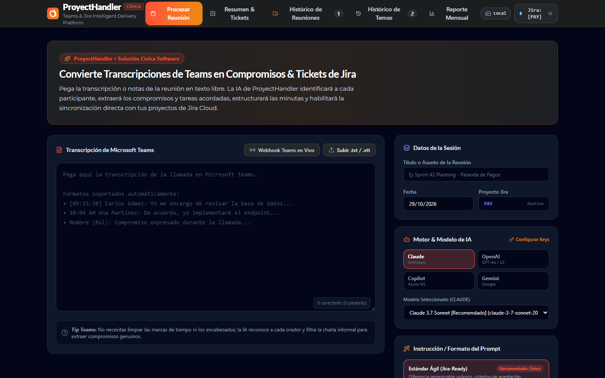
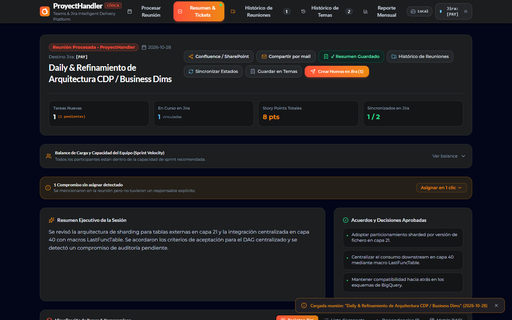
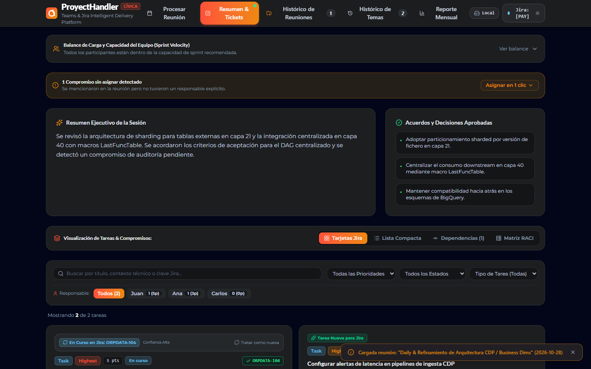
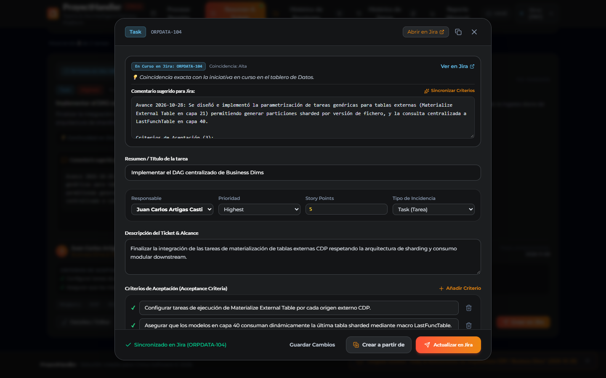
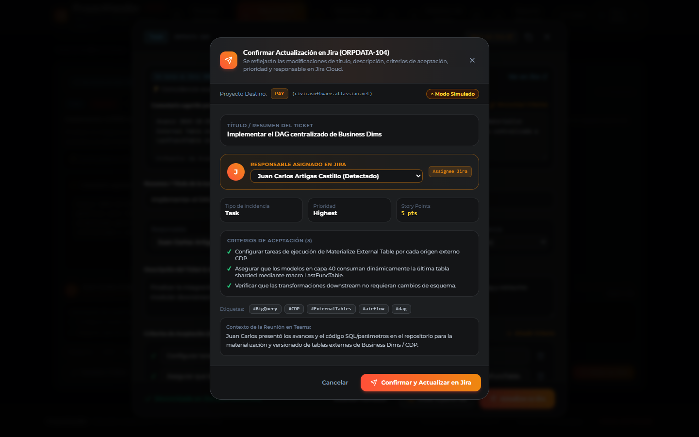
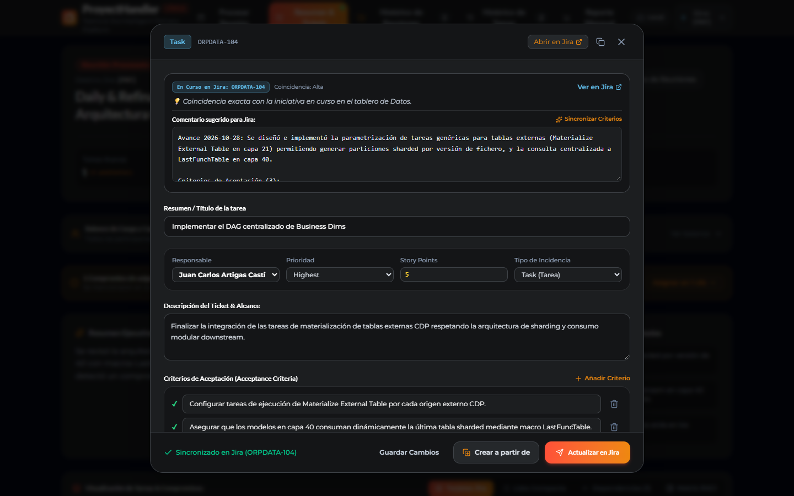
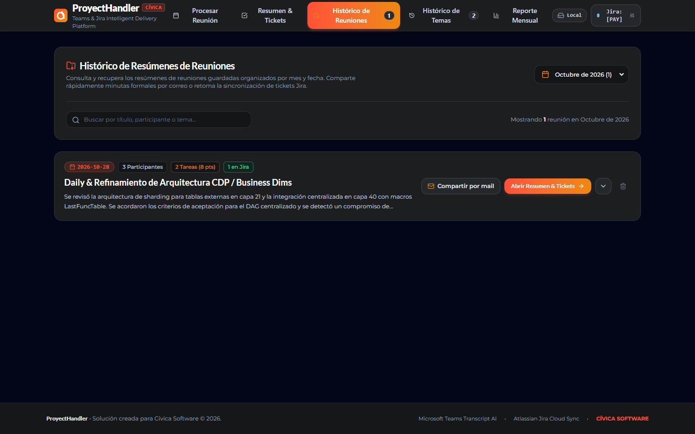
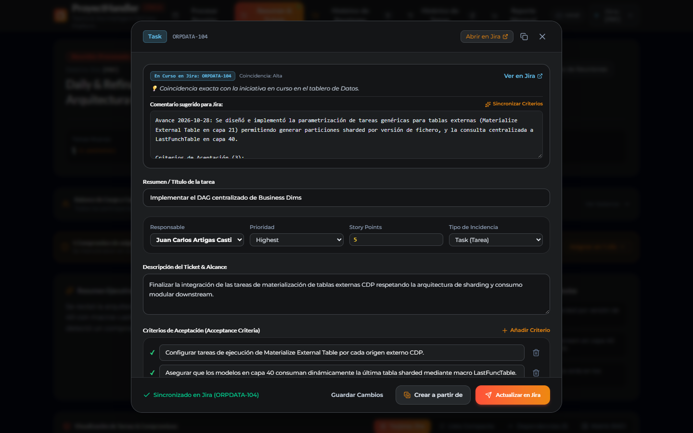

# Guía Visual de la Interfaz Gráfica de ProjectHandler 🎨

> **Plataforma Integral de Gestión Inteligente y Automatizada de Reuniones Ágiles**  
> Desarrollado por **Cívica Software**

Esta guía proporciona un recorrido visual completo y detallado por cada una de las pantallas, componentes interactivos, modales y flujos operativos de **ProjectHandler**. Las capturas corresponden a la versión activa del sistema operando con datos representativos de entrega técnica y de negocio.

---

## 📋 Tabla de Contenidos

1. [Arquitectura de la Interfaz y Barra de Navegación](#1-arquitectura-de-la-interfaz-y-barra-de-navegación)
2. [Pestaña: Procesar Reunión (Ingesta y Selección de IA)](#2-pestaña-procesar-reunión-ingesta-y-selección-de-ia)
3. [Pestaña: Resumen & Tickets (Panel Central de Entrega)](#3-pestaña-resumen--tickets-panel-central-de-entrega)
4. [Tratamiento Diferenciado: Tareas en Curso vs. Tareas Nuevas](#4-tratamiento-diferenciado-tareas-en-curso-vs-tareas-nuevas)
5. [Ventana Flotante Ampliada de Edición de Incidencias](#5-ventana-flotante-ampliada-de-edición-de-incidencias)
6. [Modal de Confirmación Contextual en Jira Cloud](#6-modal-de-confirmación-contextual-en-jira-cloud)
7. [Vistas Analíticas Especializadas (RACI, Dependencias, Tabla)](#7-vistas-analíticas-especializadas-raci-dependencias-tabla)
8. [Pestaña: Histórico de Reuniones](#8-pestaña-histórico-de-reuniones)
9. [Pestaña: Histórico de Temas (Trazabilidad Longitudinal)](#9-pestaña-histórico-de-temas-trazabilidad-longitudinal)
10. [Pestaña: Reporte Mensual Consolidado](#10-pestaña-reporte-mensual-consolidado)
11. [Modal de Configuración Global del Proyecto](#11-modal-de-configuración-global-del-proyecto)
12. [Resumen de Flujos Operativos Recomendados](#12-resumen-de-flujos-operativos-recomendados)

---

## 1. Arquitectura de la Interfaz y Barra de Navegación

La interfaz de ProjectHandler está construida con un sistema de diseño oscuro de alto contraste (*Dark Mode* profesional), optimizado para reducir la fatiga visual en sesiones prolongadas de gestión y desarrollo.

### Barra de Navegación Global (Header Sticky)

La cabecera superior permanece visible en todo momento y contiene:

1. **Isotipo & Logotipo Cívica ProjectHandler:** Identidad corporativa y acceso al estado principal.
2. **Pestañas de Navegación Principal:**
   - **Procesar Reunión:** Entrada de transcripciones y configuración de ejecución del modelo de IA.
   - **Resumen & Tickets:** Panel de control de la sesión activa, métricas, compromisos y publicación en Jira/Confluence. Incluye un indicador visual pulsante verde (`animate-pulse`) cuando hay una reunión activa cargada en memoria.
   - **Histórico de Reuniones:** Archivo cronológico ordenado por meses con buscador contextual. Muestra una insignia con el conteo de reuniones registradas.
   - **Histórico de Temas:** Repositorio de iniciativas a largo plazo con cálculo de avance acumulado y clave de Jira.
   - **Reporte Mensual:** Consolidación mensual ejecutiva para comités de dirección y stakeholders.
3. **Acciones Globales:**
   - **Botón de Configuración del Proyecto (⚙️):** Abre el modal integral para configurar Jira Cloud, Confluence, claves de IA, modelos personalizados, Story Points, catálogo de usuarios y persistencia de base de datos.
   - **Indicador de Modo Simulación:** Advierte de manera visible si el sistema está ejecutando pruebas sin alterar tableros reales de Jira.

---

## 2. Pestaña: Procesar Reunión (Ingesta y Selección de IA)

Esta pantalla permite introducir el contenido de las llamadas y personalizar el enfoque de análisis antes de ejecutar el motor de Inteligencia Artificial.



### Componentes Clave de la Pantalla de Entrada:

1. **Zona de Carga de Ficheros (Drag & Drop):**  
   Permite arrastrar o seleccionar archivos en formato `.vtt` (subtítulos descargados de Teams), `.txt` o `.docx`. Al soltar el archivo, el sistema extrae automáticamente el texto limpio y rellena el título de la reunión con el nombre del documento.
2. **Editor de Transcripción Directa:**  
   Área de texto de alta capacidad donde se puede pegar directamente la transcripción copiada del chat o grabación de Microsoft Teams.
3. **Metadatos de la Sesión:**  
   Campos editables para el **Título de la Reunión** (ej. *"Daily & Refinamiento de Arquitectura CDP"*) y la **Fecha de la Sesión** (por defecto la fecha actual).
4. **Selector de Motor de IA Multi-Proveedor:**  
   Pestañas para seleccionar entre **Anthropic Claude**, **OpenAI**, **Microsoft Copilot / Azure** o **Google Gemini**. Cada botón muestra el logotipo del proveedor y su estado de conectividad.
5. **Selector de Modelos (Oficiales y Personalizados):**  
   Desplegable con los modelos configurados en variables de entorno (`.env`), ordenados por velocidad y con distintivos informativos (*Recomendado*, *Popular*, *Empresarial*). Los modelos personalizados validados se incorporan automáticamente a esta lista.
6. **Selector de Enfoque Analítico (Modo de Prompt):**  
   - **Estándar Ágil (Jira-Ready):** Tareas concretas, Story Points en escala Fibonacci, Definition of Done y Criterios de Aceptación.
   - **Ejecutivo (Dirección):** Acuerdos estratégicos, decisiones comerciales y riesgos.
   - **Técnico (Arquitectura):** Runbooks, diagramas, esquemas SQL, pipelines y dependencias.
   - **Personalizado (Custom):** Editor libre con variables dinámicas (`{meetingTitle}`, `{meetingDate}`) y 3 ranuras (*slots*) de guardado rápido.
7. **Monitor de Teams Webhook:**  
   Tarjeta que notifica en tiempo real si el flujo de Microsoft Power Automate ha entregado una nueva reunión desde OneDrive o Graph API, permitiendo importarla con un solo clic.
8. **Botón Principal "Procesar Reunión con IA":**  
   Inicia la extracción estructurada garantizando un esquema JSON estricto sin alucinaciones.

---

## 3. Pestaña: Resumen & Tickets (Panel Central de Entrega)

Una vez analizada la reunión, esta pestaña se convierte en el centro de comando para la gestión y sincronización de entregables.



### Estructura de la Vista:

1. **Resumen Ejecutivo y Puntos Decisivos:**  
   Muestra un desglose sintetizado de lo conversado en la reunión y las **Decisiones Clave** adoptadas por el equipo.
2. **Métricas de Capacidad del Sprint (Story Points):**  
   Tarjeta analítica que compara los Story Points asignados a cada participante frente al umbral máximo configurado (ej. 8 puntos por sprint). Si un miembro excede el límite, se activa una alerta visual de sobrecarga.
3. **Compromisos Huérfanos (*Orphan Commitments*):**  
   Bloque interactivo que lista compromisos verbales detectados en la llamada que carecen de responsable explícito. Permite desplegar la lista de miembros del equipo y asignar al dueño definitivo con un clic, convirtiéndolo inmediatamente en una tarjeta formal.
4. **Barra Superior de Herramientas de Publicación:**  
   - **Sincronizar todos:** Envía masivamente a Jira únicamente las **tareas nuevas**, protegiendo el tablero de duplicaciones.
   - **Sincronizar estados:** Consulta en tiempo real a Jira Cloud y refresca el estado de los tickets vinculados (*To Do*, *In Progress*, *Done*).
   - **Publicar en Confluence:** Despliega el modal de generación y subida de acta oficial con jerarquía corporativa.
   - **Compartir por Email:** Abre el generador de correos ejecutivos formateados para clientes o gerencia.
   - **Exportar:** Permite descargar la minuta en formato Markdown (`.md`) o CSV.

---

## 4. Tratamiento Diferenciado: Tareas en Curso vs. Tareas Nuevas

ProjectHandler distingue automáticamente si un compromiso discutido en la llamada pertenece a una iniciativa ya registrada en Jira o si debe originar un nuevo ticket.



### Anatomía de una Tarjeta en Curso (`taskKind: 'existing'`):

1. **Insignia "En Curso en Jira (CLAVE)":**  
   Muestra la clave asignada (ej. `ORPDATA-104`), el nivel de coincidencia (*Alta*, *Media*) y un enlace directo para abrir la incidencia en la web de Jira.
2. **Resumen y Alcance:**  
   Título y descripción técnica acordados en la sesión.
3. **Continuidad en Jira (Contexto):**  
   Detalle de los avances presentados por el participante durante la reunión.
4. **Caja de Comentario Sugerido para Jira (con Auto-Ajuste de Altura Dinámico):**  
   Área reactiva que se expande automáticamente al tamaño exacto de su contenido sin barras de scroll forzadas ni tiradores manuales de esquina. La IA redacta el avance diario estructurado:
   ```text
   Avance YYYY-MM-DD: [Resumen conciso y técnico de novedades...]

   Criterios de Aceptación (N):
   [Criterio 1 acordado o verificado]
   [Criterio 2 acordado o verificado]
   [Criterio 3 acordado o verificado]
   ```
5. **Botón "Sincronizar Criterios" (✨):**  
   Ubicado junto al comentario. Si el gestor añade o edita criterios en la tarjeta, al hacer clic en este botón se regenera el bloque de criterios dentro del comentario sugerido sin borrar las notas de avance redactadas.
6. **Botón "Actualizar Comentario":**  
   Envía el comentario a Jira Cloud estructurado en Atlassian Document Format (ADF). Si ya se había publicado un comentario en la sesión actual, **actualiza la entrada existente en Jira (`PUT`)** en lugar de crear un comentario duplicado.
7. **Botón "Detalles / Editar":**  
   Abre la ventana flotante ampliada para modificar a fondo el ticket, asociar épica o tema, dividir criterios o derivar una nueva tarea.

---

## 5. Ventana Flotante Ampliada de Edición de Incidencias

Al presionar **"Detalles / Editar"**, se abre un modal espacioso (`max-w-4xl`) diseñado específicamente para la lectura y edición cómoda de especificaciones técnicas complejas.



### Secciones del Editor Integral:

1. **Resumen / Título de la Tarea:** Campo de texto amplio con el título en formato infinitivo ágil.
2. **Tema / Iniciativa Asociada (Selector Híbrido):**  
   Permite asociar la tarea a cualquier tema activo o histórico, o seleccionar **`+ Crear nuevo tema...`** especificando su nombre y categoría funcional de proyecto.
3. **Épica Padre en Jira (Parent Epic):**  
   Selector dinámico que recupera en tiempo real las épicas activas de Jira Cloud para asociar la tarea como hija formal en la jerarquía de Atlassian.
4. **Selectores de Gestión y Metadatos:**  
   - **Responsable:** Desplegable con autocompletado y resolución de cuentas de Jira Cloud (`accountId`).
   - **Prioridad:** *Highest*, *High*, *Medium*, *Low*.
   - **Story Points:** Puntuación en escala Fibonacci.
   - **Tipo de Incidencia:** *Task*, *Story*, *Bug*, *Spike*.
5. **Descripción del Ticket & Alcance (Auto-Ajustable):**  
   Texto principal del entregable con auto-expansión reactiva según su contenido. Se transfiere de forma **completamente limpia** a Jira Cloud, sin prefijos ni encabezados intrusivos.
6. **Criterios de Aceptación Dinámicos y División de Tareas (Split Criteria):**  
   - Lista interactiva de criterios con campos independientes y supresión rápida.
   - **Botón "Asignar criterios de aceptación a la nueva tarea":** Activa casillas de verificación al lado de cada criterio con opciones rápidas de *Marcar todos* / *Desmarcar todos* y distintivo `→ Nueva tarea`. Permite seleccionar con precisión qué criterios se mueven a la tarea derivada y cuáles permanecen en el ticket original.
   - **Casilla de Actualización:** Permite actualizar opcionalmente el ticket original en Jira Cloud eliminando los criterios movidos y refrescando el comentario sugerido.
7. **Contexto de Discusión en Teams (Auto-Ajustable):**  
   Espacio reservado para antecedentes, notas verbales o dependencias surgidas en la llamada con auto-altura dinámica.
8. **Etiquetas en Jira (Labels):**  
   Chips interactivos removibles (`#BigQuery`, `#CDP`, `#airflow`) y caja rápida con botón **"+ Añadir"** para incorporar nuevos tags.
9. **Botonera Operativa Inferior (Alineada y Ergonómica):**  
   - **Guardar Cambios:** Guarda las modificaciones en el estado local de la reunión.
   - **"Crear a partir de" (Clonar/Derivar):** Genera una **nueva tarea independiente en Jira Cloud** a partir de este contenido, vinculándola al tema y épica elegidos y asociando únicamente los criterios seleccionados.
   - **"Actualizar en Jira" (Modificación Directa):** Aplica los cambios directamente sobre el ticket existente en Jira Cloud (`PUT /rest/api/3/issue/{key}`), actualizando resumen, descripción con criterios formateados en ADF, prioridad, responsable, etiquetas y épica padre.

---

## 6. Modal de Confirmación Contextual en Jira Cloud

Para evitar errores operativos o modificaciones accidentales en los tableros del cliente, ProjectHandler despliega un diálogo de confirmación inteligente antes de ejecutar cualquier mutación en la API de Atlassian.



### Modos del Diálogo de Confirmación:

| Modo Operativo | Título del Diálogo | Advertencia y Propósito |
| :--- | :--- | :--- |
| **`update`** | *Confirmar Actualización en Jira (CLAVE)* | Advierte que se modificarán los campos de la incidencia productiva existente en Jira Cloud y solicita confirmación explícita. Permite revisar responsable, tema, épica padre y criterios de aceptación. |
| **`clone`** | *Confirmar Creación Derivada en Jira* | Explica que se originará una nueva tarea con clave correlativa manteniendo intacta la tarjeta en curso. Incluye opciones avanzadas de vinculación y división de criterios. |
| **`create`** | *Confirmar Creación de Tarjeta en Jira* | Permite revisar y ajustar el responsable, tema asociado, épica padre y criterios antes de sincronizar una tarea nueva con Atlassian. |

### Controles Avanzados en Modo Derivación (`clone`):

1. **Vinculación Nativa en Jira Cloud (`Issue Linking`):**  
   Permite elegir la relación formal con el ticket de origen (*Relacionado con*, *Es bloqueada por*, *Bloquea a*, *Clonada de* o *Sin vínculo*). Si se escoge una relación de bloqueo, se activa una insignia destacada advirtiendo que la relación se incorporará automáticamente al **Grafo de Dependencias**.
2. **Resumen de División de Criterios de Aceptación:**  
   Si se activó la división de criterios en la ventana de edición, se despliega una tarjeta de auditoría que resume cuántos criterios se asignan a la nueva tarea y cuántos permanecerán en el ticket previo.
3. **Actualización del Ticket Original en Jira Cloud:**  
   Casilla de verificación opcional para retirar en la misma operación los criterios seleccionados del ticket original en Jira Cloud.
4. **Selectores de Tema y Épica Padre:**  
   Permite ratificar o modificar el tema/iniciativa y la épica padre a la que pertenecerá la nueva tarea.

---

## 7. Vistas Analíticas Especializadas (RACI, Dependencias, Tabla)

En la zona superior de la pestaña **Resumen & Tickets**, una botonera segmentada permite alternar entre cuatro perspectivas complementarias:

### Matriz RACI Automatizada

Cruza cada entregable técnico con los roles del equipo según la metodología RACI (*Responsible*, *Accountable*, *Consulted*, *Informed*).


- **Responsible (R):** Quién ejecuta técnicamente la tarea.
- **Accountable (A):** Quién responde por la entrega ante el cliente o negocio.
- **Consulted (C):** Especialistas a los que se consulta soporte técnico o diseño.
- **Informed (I):** Personas informadas del progreso.

---

### Mapa y Grafo de Dependencias

Identifica de forma visual qué participante o tarea bloquea el avance de otra iniciativa del sprint.


- Señala con claridad el **Emisor del Bloqueo** (*Blocker*) y el **Receptor Afectado** (*Blocked*).
- Explica la naturaleza técnica de la dependencia (ej. *"Las alertas requieren que los nombres y esquemas sharded estén normalizados en capa 21"*).
- **Alimentación Dinámica:** Las relaciones de bloqueo seleccionadas al derivar tareas (`Es bloqueada por` o `Bloquea a`) se incorporan de forma automática a este mapa, permitiendo trazar caminos críticos en tiempo real.

---

### Vista de Tabla Compacta

Diseñada para revisiones rápidas con Product Owners y Scrum Masters durante ceremonias de refinamiento.



- Despliega en una cuadrícula densa: Clave de Jira, Título de la Tarea, Responsable, Prioridad, Puntos de Historia y Estado en tiempo real.
- Permite abrir la URL del ticket de Jira con un solo clic.

---

## 8. Pestaña: Histórico de Reuniones

Catálogo ordenado cronológicamente que preserva el registro histórico de todas las sesiones analizadas por el equipo.



### Capacidades del Archivo de Reuniones:

1. **Filtro Mensual y Buscador Dinámico:**  
   Permite seleccionar cualquier mes del calendario o buscar por palabras clave presentes en el título, transcripción, acuerdos o participantes.
2. **Métricas Agregadas del Mes:**  
   Contadores en la cabecera con el total de sesiones procesadas, compromisos totales y Story Points acumulados.
3. **Acciones por Reunión:**  
   - **"Abrir Resumen & Tickets":** Carga inmediatamente la sesión en la pestaña principal, permitiendo continuar la gestión o sincronización con Jira.
   - **"Compartir por mail":** Genera la plantilla formal en HTML/Markdown para remitir a clientes.
   - **Desplegable de Detalles (Chevron):** Permite consultar acuerdos sin abandonar el histórico.
   - **Eliminar (Papelera):** Permite depurar reuniones obsoletas.

---

## 9. Pestaña: Histórico de Temas (Trazabilidad Longitudinal)

Esta vista resuelve el problema de la fragmentación de compromisos agrupando los temas tratados a lo largo de semanas o meses de trabajo.



### Elementos de Seguimiento de Iniciativas:

1. **Tarjeta de Iniciativa:**  
   Título del tema, categoría técnica (ej. *Arquitectura & Datos*, *DevOps & Cloud*) y estado actual (*En Progreso*, *Completado*, *Bloqueado*).
2. **Barra de Progreso y Claves de Jira:**  
   Cálculo porcentual del avance acumulado e insignias interactivas con los tickets de Jira vinculados (ej. `ORPDATA-104`, `ORPDATA-98`).
3. **Historial de Sesiones:**  
   Lista cronológica de las reuniones donde se debatió este tema con sus respectivos resúmenes de avance.
4. **Fusión de Temas (*Merge Topics*):**  
   Herramienta integrada para unificar dos temas duplicados o derivados bajo un único hilo evolutivo.

---

## 10. Pestaña: Reporte Mensual Consolidado

Herramienta diseñada para Product Managers, Directores de Proyecto y Comités de Seguimiento.


### Estructura del Informe Mensual:

1. **Selector de Período:**  
   Permite elegir el mes a consolidar (ej. *Octubre 2026*) y ejecutar el motor de IA mediante el botón **"Generar Reporte Mensual con IA"**.
2. **Síntesis Ejecutiva:**  
   Resumen narrativo de alto nivel sobre la marcha del proyecto durante el mes.
3. **Principales Logros Alcanzados:**  
   Hitos técnicos completados y entregas de valor realizadas.
4. **Temas Pendientes y Riesgos:**  
   Tabla de iniciativas con asignación, estado y nivel de riesgo de bloqueo para el siguiente período.
5. **Balance de Carga por Participante:**  
   Gráfica de tareas asumidas, tasa de finalización y foco funcional predominante de cada miembro del equipo.
6. **Velocidad del Equipo y Recomendaciones Estratégicas:**  
   Conclusiones cuantitativas de velocidad ágil y directrices para el siguiente ciclo de sprint.

---

## 11. Modal de Configuración Global del Proyecto

Accesible desde el icono de engranaje (⚙️) en la cabecera superior. Centraliza todos los parámetros técnicos de integración.


### Pestañas de Configuración:

1. **Jira Cloud & Confluence:**  
   - Dominio de Atlassian (ej. `civicasoftware.atlassian.net`).
   - Clave del Proyecto (`PAY`, `ORPDATA`, etc.) y Nombre del Tablero Scrum.
   - Correo electrónico del usuario y API Token personal de Atlassian.
   - Espacio predeterminado de Confluence para publicación de actas.
   - Conmutador de **Modo Simulación** para pruebas sin mutaciones productivas.
2. **Proveedores de Inteligencia Artificial:**  
   - Introducción de API Keys para Claude, OpenAI, Azure Copilot y Gemini.
   - Alta de **Modelos Personalizados** con validación interactiva inmediata (**"Probar y Guardar"**).
3. **Story Points & Capacidad:**  
   - Personalización de la escala Fibonacci (`[1, 2, 3, 5, 8, 13, 21]`).
   - Puntuación por defecto para nuevas tareas.
   - Límite de capacidad por sprint por miembro (para alertas de sobreasignación).
4. **Catálogo de Miembros del Equipo:**  
   - Gestión de nombres, correos de Jira, roles y capacidades individuales.
5. **Base de Datos & Persistencia Agnóstica:**  
   - Configuración de persistencia centralizada en **PostgreSQL**, **Snowflake Data Warehouse**, **MySQL**, **MongoDB** o **SQLite**, manteniendo garantizado el respaldo en `localStorage`.

---

## 12. Resumen de Flujos Operativos Recomendados

```mermaid
flowchart TD
    subgraph Daily["Ceremonia Diaria (Daily Scrum - 15 min)"]
        D1["Pegar transcripción breve de Teams"] --> D2["Procesar con Modo Estándar Ágil"]
        D2 --> D3["Revisar comentarios de avance sugeridos"]
        D3 --> D4["Clic en 'Actualizar Comentario' (In-place en Jira)"]
        D4 --> D5["Sincronizar tareas nuevas con 'Sincronizar todos'"]
    end

    subgraph Refinement["Refinamiento de Backlog (Grooming)"]
        R1["Cargar transcripción técnica o runbook"] --> R2["Procesar con Modo Técnico"]
        R2 --> R3["Revisar Criterios de Aceptación en modal ampliado"]
        R3 --> R4["Ajustar Story Points y Responsable"]
        R4 --> R5["Validar Dependencias en Grafo Interactivo"]
        R5 --> R6["Actualizar en Jira o Crear a partir de"]
    end

    subgraph Comite["Comité Mensual de Dirección"]
        C1["Acceder a Pestaña Reporte Mensual"] --> C2["Seleccionar Mes en curso"]
        C2 --> C3["Generar Reporte con IA"]
        C3 --> C4["Publicar Acta Oficial en Confluence"]
        C4 --> C5["Compartir Síntesis Ejecutiva por Email"]
    end
```



---

<p align="center">
  <b>ProjectHandler</b> • Diseñado para la excelencia operativa y la agilidad continua.<br/>
  <i>Cívica Software © 2026</i>
</p>

